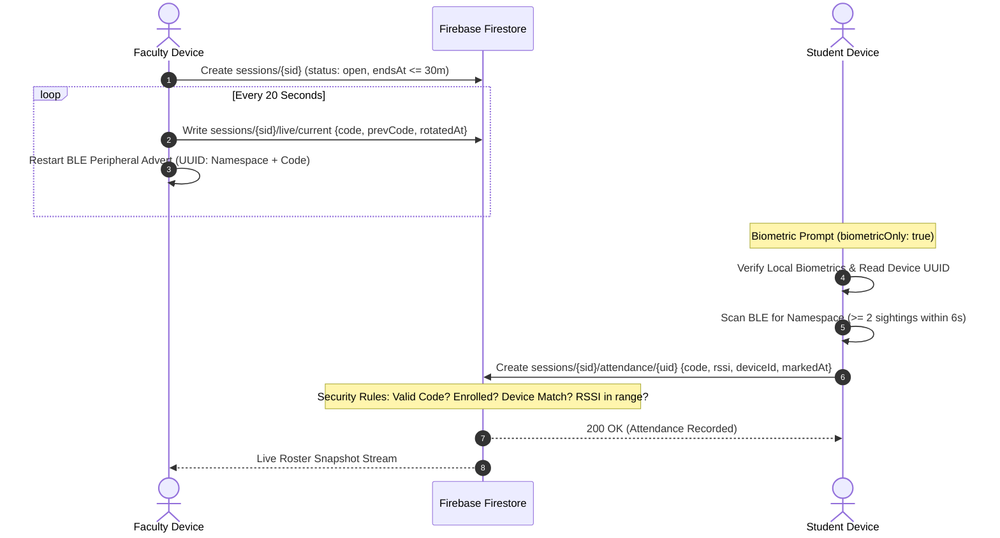

# Amrita Attendance Platform

Enterprise Bluetooth Low Energy (BLE) proximity attendance tracking system for Amrita Vishwa Vidyapeetham. Built with Flutter and Firebase.

[](https://github.com/priyanrajj-hub/attendance-ble-platform/actions/workflows/ci.yml)

---

## Architecture Overview (Decision D2)

The platform operates on an inverted beacon model:
1. **Faculty Broadcaster:** The faculty device starts a classroom session and broadcasts a rotating 128-bit BLE Service UUID. The UUID consists of a 12-byte fixed institutional namespace and a 4-byte rotating cryptographic nonce generated via `Random.secure()`.
2. **Rotating Token Engine:** The nonce rotates every 20 seconds. The faculty device writes `{code, prevCode, rotatedAt: serverTimestamp}` to Firestore at `sessions/{sid}/live/current`, then updates its BLE peripheral advertisement.
3. **Student Scanner & Attendance Claim:** The student device verifies biometric presence, scans for the institutional beacon, records the rotating nonce with mean RSSI, and submits the claim to `sessions/{sid}/attendance/{uid}`.
4. **Zero-Trust Firestore Security Rules:** The Firestore security rules validate that the submitted nonce matches `current.code` or `current.prevCode`, that the student is enrolled, that the session is open, that the device UUID matches the student's registered hardware binding, and that the RSSI is within physical classroom thresholds.



---

## Role Matrix & Workflows

| Role | Allowed Email Domain | Permissions & Flow |
| :--- | :--- | :--- |
| **Student** | `@ch.students.amrita.edu` | Self-registration, biometrics verification, BLE scanner check-in, collection-group attendance history view. |
| **Faculty** | `@ch.amrita.edu` | Self-registration, assigned courses dashboard, live session creation & code rotator broadcaster, live roster inspection, manual overrides. |
| **Admin** | Console-promoted | User approvals/rejections with reason, suspension, hardware device resets, course creation, student enrollment. |

---

## Security Model & Honest Technical Limitations

No automated wireless attendance system can provide 100% cryptographic proof of physical human presence without trusted hardware constraints. This platform provides multi-layered defenses with the following honest operational boundaries:

### Mitigations
1. **Rotating Ephemeral Nonces:** The BLE broadcast rotating code changes every 20 seconds. A code intercepted in one window becomes invalid shortly thereafter.
2. **Grace Overlap:** Security rules accept `code` and `prevCode` (a ~40-second total validity window) to account for RF packet loss, scan latency, and device clock drift.
3. **Hardware Device Binding:** On first login, a UUIDv4 is stored in `flutter_secure_storage` and committed to `users/{uid}.deviceId` once. Subsequent check-ins require this device ID, preventing account-sharing across phones without administrator reset.
4. **Biometric Presence Gate:** Every check-in strictly requires `biometricOnly: true` (no device PIN fallback).
5. **Physical RSSI Gate:** Claims are rejected by client validation if mean signal strength falls below `-80 dBm`.
6. **Audit Trail for Overrides:** Any manual faculty attendance override requires a recorded reason and records the faculty member's UID.

### Known Attack Surfaces & Limitations
- **Relay over messaging apps:** If a student physically inside the classroom relays the 8-hex rotating code to an absent peer over chat or messaging, the absent peer could theoretically submit the code within the ~40-second validity window if their device is bound and their IP is unblocked.
- **Biometrics Scope:** `local_auth` returns a boolean indicating *someone enrolled in the phone's OS biometrics* authenticated. It cannot verify that the enrolled fingerprint belongs to the student rather than a friend whose fingerprint was added to the device settings.
- **Rooted / Modified Devices:** A modified app client running on a rooted device with Frida/Xposed can hook return values or simulate arbitrary RSSI readings.

---

## Setup & Development

### Prerequisites
- Flutter SDK 3.22+ (`flutter doctor`)
- OpenJDK 21 LTS (required for Firebase Firestore Emulator)
- Node.js 20 LTS & Firebase CLI 13+

### Local Emulator Testing
```bash
# Run automated Firestore security rules suite (38 test cases)
cd firestore-tests
npm ci
firebase emulators:exec --only firestore "npm test"
cd ..

# Run Flutter static analysis & unit tests
flutter analyze --fatal-infos
flutter test --coverage
```

### Creating the First Administrator
In Firebase Console > Firestore Database > `users` collection:
1. Locate the document matching your administrator's Firebase Auth UID.
2. Set:
   ```json
   {
     "name": "System Administrator",
     "email": "admin@ch.amrita.edu",
     "role": "admin",
     "status": "verified",
     "createdAt": "<Timestamp>"
   }
   ```

### Production Release Build
```bash
# Build release APK split by ABI with symbol obfuscation
flutter build apk --release --split-per-abi --obfuscate --split-debug-info=build/symbols
```
Build outputs:
- `build/app/outputs/flutter-apk/app-armeabi-v7a-release.apk`
- `build/app/outputs/flutter-apk/app-arm64-v8a-release.apk`
- `build/app/outputs/flutter-apk/app-x86_64-release.apk`
