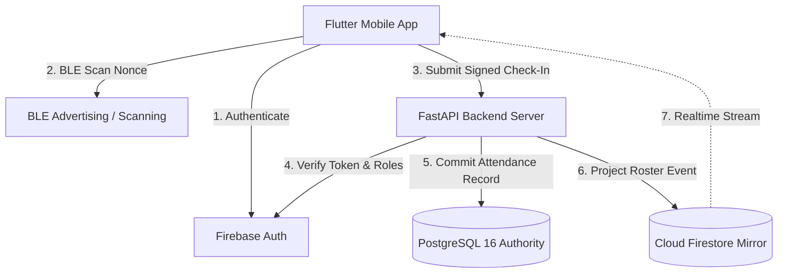

# SYSTEM ARCHITECTURE & DATA SPECIFICATION
**Amrita BLE Proximity Attendance Platform**  

---

## 1. Architectural Principles

1. **PostgreSQL as Sole Authoritative State**:
   - Cloud Firestore is strictly a non-authoritative read-only projection mirror for client UI reactivity.
   - Client applications never write directly to attendance records.
   - All attendance write mutations route through FastAPI REST endpoints and persist in PostgreSQL 16 ACID transactions.

2. **Cryptographic Proximity Proofs**:
   - Presence in the lecture hall is proven by receiving an ephemeral BLE manufacturer data packet containing a 128-bit rotating code generated by HMAC-SHA256 with a 256-bit session secret.
   - Possession of the registered student device is proven by an asymmetric signature from Android Keystore / iOS Keychain.

3. **Multi-Platform Zero-Trust Topology**:
   - Flutter mobile client targeting Android 8.0+ (API 26+) and iOS 14.0+.
   - Containerized FastAPI backend with asynchronous connection pool (`asyncpg`).
   - Production PostgreSQL 16 cluster with automated Alembic migrations.

---

## 2. Component Diagram

