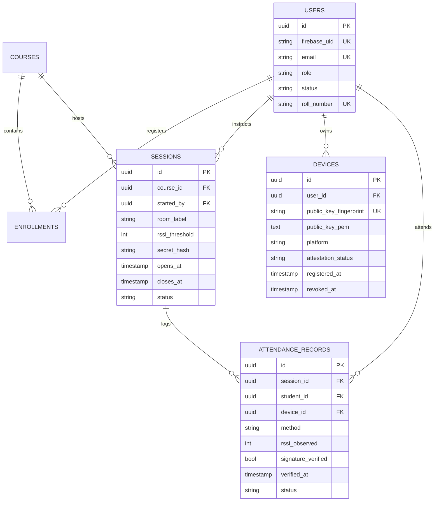

# POSTGRESQL 16 DATABASE SCHEMA
**Amrita BLE Proximity Attendance Platform**  

---

## 1. Relational Entity ERD

---

## 2. Table Constraints & Indices

1. `attendance_records`:
   - Unique Constraint: `UniqueConstraint("session_id", "student_id", name="uq_session_student")`
   - Check Constraint: `CheckConstraint("method IN ('ble_signed_nonce', 'faculty_manual_override')", name="check_attendance_method")`
   - Check Constraint: `CheckConstraint("status IN ('present', 'disputed', 'revoked')", name="check_attendance_status")`
   - Index: `Index("idx_attendance_student", "student_id", "verified_at")`

2. `devices`:
   - Partial Index: `Index("idx_devices_user", "user_id", postgresql_where=("revoked_at IS NULL"))`
   - Check Constraint: `CheckConstraint("platform IN ('android', 'ios')", name="check_device_platform")`
