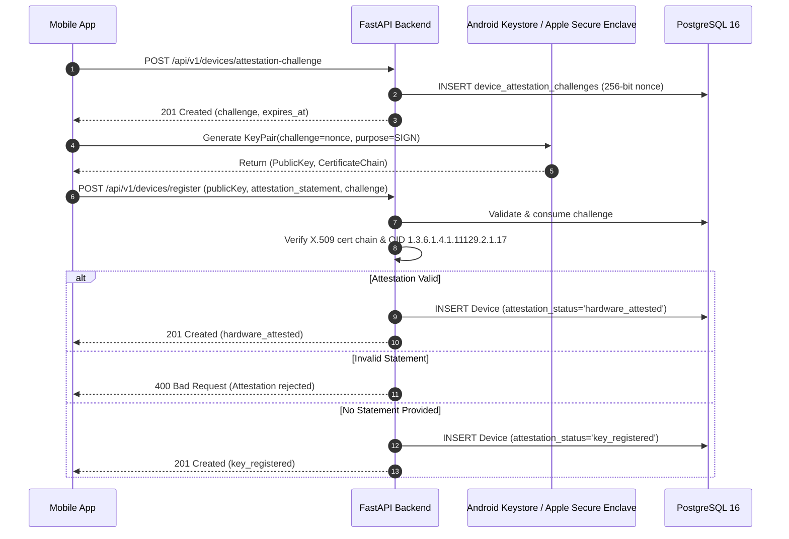

# HARDWARE DEVICE BINDING & REMOTE ATTESTATION ARCHITECTURE
**Amrita BLE Proximity Attendance Platform**  

---

## 1. Trust Hierarchy & Attestation Tiers

To prevent proxy attendance and emulator spoofing, the platform defines a clear two-tier attestation hierarchy:

```
[Tier 1: Key Registration ('key_registered')]
  ├── Enrolls client-generated ECDSA P-256 / RSA public key
  ├── Replaces existing device (strict 1:1 user-to-device mapping)
  └── SECURITY BOUNDARY: Authenticates device ownership; does NOT prove hardware isolation
                         without remote attestation statement.

[Tier 2: Hardware Attested ('hardware_attested')]
  ├── 1. Client requests challenge: POST /api/v1/devices/attestation-challenge
  ├── 2. Client generates key in hardware Keystore / Secure Enclave with challenge
  ├── 3. Client submits certificate chain / Play Integrity token
  ├── 4. Backend validates X.509 Key Attestation extension (1.3.6.1.4.1.11129.2.1.17)
  └── SECURITY BOUNDARY: Cryptographically verifies key generation inside TEE / StrongBox.
```

---

## 2. Remote Attestation Verification Flow



---

## 3. Explicit Security Claims & Limitations

1. **Without Hardware Attestation (`key_registered`)**:
   - The server verifies that check-ins originate from the registered public key.
   - However, a student running a modified client or software emulator could export or generate keys in software.
2. **With Hardware Attestation (`hardware_attested`)**:
   - Google hardware root certificate chain guarantees private keys never leave the hardware security module (StrongBox or ARM TrustZone).
   - Keys cannot be extracted or cloned to other devices.
