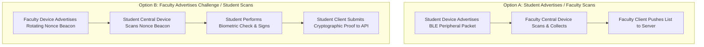

# BLE Attendance Platform — Master Specification & Implementation Plan

**Target System**: Institutional BLE Proximity Mobile Attendance Platform  
**Target Institution (Launch)**: Amrita Vishwa Vidyapeetham (CCE, Chennai Campus)  
**Budget Constraint**: Strict $0.00 / Month Free-Tier Ceiling (Zero Credit Card Required)  
**Document Version**: 2.0.0 (Production Blueprint)  

---

## 1. Product Scope, User Roles & Application Navigation

### 1.1. Role Matrix & Capabilities

| Capability | Student | Faculty | Admin |
| :--- | :---: | :---: | :---: |
| **Authentication** | Institutional Email (`@ch.students.amrita.edu`) | Institutional Email (`@ch.amrita.edu`) | Institutional Admin Email |
| **Account Creation** | Self-signup + Email Verification | Self-signup + Email Verification + Admin Approval | Seeded via backend / console |
| **Course Enrollment** | Ingested via Roster / Join Request | Owns assigned courses | Global access across all courses |
| **Session Control** | Join & Poll attendance only | Create, start, pause, close sessions | View all sessions (audited) |
| **Proximity Configuration** | Monitored by BLE RSSI envelope | Sets BLE RSSI sensitivity threshold | Overrides institutional defaults |
| **Attendance Verification** | Biometric prompt + BLE signed nonce | Scans/receives tokens, compiles live roster | Audits anomalies & proxy flags |
| **Overrides & Disputes** | Submits dispute ticket with reason | Approves/rejects with audit note | Final escalation arbiter |
| **Reporting & Export** | Views own attendance & warnings | Exports course CSV/PDF summaries | Exports institutional compliance logs |
| **Account Deletion** | Right to erasure (DPDP Act) | Right to erasure (anonymized records) | Manages tenant data purge |

---

### 1.2. Screen Catalog by Role

#### Shared Authentication Screens
1. **`PortalGateScreen`**: Entry split selecting *Student Portal* or *Faculty Portal*.
2. **`LoginScreen`**: Institutional email/password input, domain check, biometric second factor.
3. **`RegisterScreen`**: Name, roll number, institutional email, parent contact email, password. Directs to email verification holding state.
4. **`EmailVerificationScreen`**: Polling/reload screen blocking access until email link is verified.

#### Student Screens
1. **`StudentHomeScreen`**: Displays active course cards, aggregate attendance percentage, and minimum-attendance warning banners (<75% threshold).
2. **`ActiveSessionCard`**: Visual indicator when an active session for an enrolled course is detected.
3. **`StudentCheckInScreen`**:
   - *State 1: Pre-flight Permissions*: Pre-prompts explaining why Bluetooth and Biometrics are needed (no GPS location required on Android 12+).
   - *State 2: Radio Scan / Beacon Discovery*: Listening for active classroom session beacon.
   - *State 3: Biometric Challenge Sheet*: Native BiometricPrompt (fingerprint/face) unlocking the device-bound private key.
   - *State 4: Cryptographic Handshake*: Signing rotating nonce and transmitting attendance proof.
   - *State 5: Result Screen*: Success confirmation badge with timestamp, or failure card with plain-language explanation.
4. **`StudentHistoryScreen`**: Chronological list of attended/missed lectures with course filter.
5. **`StudentDisputeScreen`**: Form to submit attendance dispensation/dispute with contextual reason.
6. **`StudentProfileScreen`**: Account info, registered device fingerprint, privacy policy, and account deletion trigger.

#### Faculty Screens
1. **`FacultyHomeScreen`**: List of assigned courses with student counts and recent lecture metrics.
2. **`CreateSessionSheet`**: Subject selector, duration picker (default 5 min), and BLE RSSI sensitivity slider (-65 dBm to -85 dBm).
3. **`FacultyActiveSessionScreen`**: Live countdown timer, start/stop scan controls, live roster counts (Present / Total).
4. **`LiveRosterList`**: Real-time list showing detected students, RSSI signal meter, verification timestamp, and manual override toggle.
5. **`ManualOverrideDialog`**: Dialog requiring faculty to select an audited reason (e.g., *Device hardware failure*, *Medical pass*, *Biometric sensor unreadable*) before manually marking present.
6. **`SessionSummaryScreen`**: Post-session analytics, proxy anomaly alerts, and export options.
7. **`CourseHistoryScreen`**: Historical attendance aggregates and CSV report download.

#### Admin Screens
1. **`AdminDashboardScreen`**: System health, active sessions count, pending user approvals.
2. **`UserApprovalScreen`**: Queue of unverified faculty accounts with approve/reject actions.
3. **`InstitutionalAuditScreen`**: Append-only audit log viewer showing user identity, action, IP hash, and timestamp.

---

### 1.3. User Flows & Failure Paths


---

## 2. Zero-Dollar ($0.00) Cloud Infrastructure & Cost Trap Analysis

To ensure absolute adherence to a **strict $0.00 / month budget ceiling**, all cloud services are selected to require **zero credit card or payment method on file**, preventing any possibility of unexpected overdrafts.

### 2.1. Verified Free-Tier Matrix (Official Documentation Citations)

| Layer | Selected Service | Verified Free-Tier Allowance | Credit Card / Billing Required? | Cost-Trap & Overdraft Prevention | Official Source Citation |
| :--- | :--- | :--- | :---: | :--- | :--- |
| **Auth & Ephemeral Live State** | **Firebase Spark Plan** | - Auth: Unlimited Email/Password<br>- Firestore: 50,000 reads/day, 20,000 writes/day, 1 GB storage<br>- Hosting: 10 GB storage, 360 MB/day egress | **NO** | Hard platform quota. Operations fail with `RESOURCE_EXHAUSTED` if exceeded; impossible to charge card. Cloud Functions blocked. | [Firebase Pricing](https://firebase.google.com/pricing) |
| **Authoritative DB & File Storage** | **Supabase (Unified)** | - 500 MB Postgres database storage<br>- 1 GB File Storage (PDF/CSV exports)<br>- 50,000 Monthly Active Users<br>- `pgvector` extension pre-installed | **NO** | Zero credit card required to sign up. Inactivity pausing (7 days without traffic) handled by keep-warm pings. No overage billing. | [Supabase Pricing](https://supabase.com/pricing) |
| **API Compute** | **Render Web Services** | - 750 free instance hours/month (runs 1 web service 24/7)<br>- 512 MB RAM, 0.1 vCPU<br>- 100 GB egress/month | **NO** | Spins down after 15 min idle; auto-wakes on HTTP request. Free tier rejects overages with 0 charge. No card needed. | [Render Free Tier Docs](https://render.com/docs/free) |
| **Edge / Proxy / TLS** | **Cloudflare Free Tier** | - Free Universal SSL/TLS<br>- DDoS mitigation<br>- Basic Web Application Firewall & rate limits | **NO** | Standard free plan requires no payment credentials for DNS, proxy caching, and TLS termination. | [Cloudflare Plans](https://www.cloudflare.com/plans/) |
| **Error Monitoring** | **Sentry Developer Tier** | - 5,000 error events/month<br>- 10,000 transaction traces/month | **NO** | Ingestion stops at limit; no automatic overage charges. | [Sentry Pricing](https://sentry.io/pricing/) |
| **CI/CD Pipeline** | **GitHub Actions** | - Unlimited build minutes for public repositories<br>- 2,000 min/mo for private | **NO** | Public repo workflows run completely free. | [GitHub Actions Billing](https://docs.github.com/billing/managing-billing-for-github-actions) |
| **AI Assistant (Phase 5 - Public Docs Only)** | **Google AI Studio (Gemini API Free)** | - 15 RPM (Requests Per Minute)<br>- 1,500 RPD (Requests Per Day)<br>- Models: `gemini-2.5-flash`, `gemini-1.5-flash-8b` | **NO** | Free tier via Google AI Studio requires only a Google login; no Cloud Billing or card needed. | [Gemini API Pricing](https://ai.google.dev/pricing) |

### 2.2. Cost Traps Explicitly Excluded
- **Google Cloud Run**: Requires a linked Cloud Billing account with an active credit card. Excluded to eliminate risk of unexpected compute or Artifact Registry charges.
- **Cloudflare R2**: Requires a payment method on file to provision buckets despite having a 10 GB free tier. Excluded in favor of **Supabase Storage** (unified, zero card required).
- **Firebase Blaze Plan**: Never upgrade the Firebase project to Blaze. Cloud Functions remain disabled, preserving client-to-backend API architecture.

---

## 3. Data Model & Dual-Store Authority

### 3.1. Entity Source of Truth Definition

| Entity | Authoritative Source of Truth | Ephemeral Cache Layer | Synchronization Mechanism |
| :--- | :--- | :--- | :--- |
| **User Identities & Roles** | **PostgreSQL** (`users` table) | Firebase Auth custom claims / Firestore `users` | Background sync on user verification / update |
| **Courses & Enrollments** | **PostgreSQL** (`courses`, `enrollments`) | None | Direct API queries |
| **Registered Devices & Keys** | **PostgreSQL** (`devices` table) | None | Verified at API check-in gate |
| **Active Sessions** | **PostgreSQL** (`sessions` table) | **Cloud Firestore** (`sessions/{id}`) | Backend creates session in both Postgres and Firestore simultaneously |
| **Attendance Records** | **PostgreSQL** (`attendance_records` table) | **Cloud Firestore** (`sessions/{id}/attendance/{uid}`) | API validates check-in, writes to Postgres, then streams receipt to Firestore |
| **Overrides & Disputes** | **PostgreSQL** (`overrides`, `disputes` tables) | None | Direct write from backend API |
| **Audit Logs** | **PostgreSQL** (`audit_log` table, append-only) | None | Direct write from backend middleware |

---

### 3.2. Complete PostgreSQL Schema (11 Tables DDL)

```sql
-- Enable UUID and Vector extensions
CREATE EXTENSION IF NOT EXISTS "uuid-ossp";
CREATE EXTENSION IF NOT EXISTS "vector";

-- 1. Institutions Table
CREATE TABLE institutions (
    id UUID PRIMARY KEY DEFAULT uuid_generate_v4(),
    code VARCHAR(32) UNIQUE NOT NULL,
    name VARCHAR(255) NOT NULL,
    domain VARCHAR(128) UNIQUE NOT NULL,
    created_at TIMESTAMPTZ DEFAULT NOW()
);

-- 2. Users Table
CREATE TABLE users (
    id UUID PRIMARY KEY DEFAULT uuid_generate_v4(),
    firebase_uid VARCHAR(128) UNIQUE NOT NULL,
    institution_id UUID REFERENCES institutions(id) ON DELETE RESTRICT,
    email VARCHAR(255) UNIQUE NOT NULL,
    role VARCHAR(32) NOT NULL CHECK (role IN ('student', 'faculty', 'admin')),
    display_name VARCHAR(255) NOT NULL,
    roll_number VARCHAR(64),
    status VARCHAR(32) DEFAULT 'pending_verification' CHECK (status IN ('pending_verification', 'verified', 'suspended')),
    created_at TIMESTAMPTZ DEFAULT NOW(),
    updated_at TIMESTAMPTZ DEFAULT NOW()
);

-- 3. Devices Table (Bound cryptographic public keys)
CREATE TABLE devices (
    id UUID PRIMARY KEY DEFAULT uuid_generate_v4(),
    user_id UUID NOT NULL REFERENCES users(id) ON DELETE CASCADE,
    public_key_fingerprint VARCHAR(128) UNIQUE NOT NULL,
    public_key_pem TEXT NOT NULL,
    platform VARCHAR(32) NOT NULL CHECK (platform IN ('android', 'ios')),
    device_model VARCHAR(128),
    os_version VARCHAR(64),
    attestation_status VARCHAR(32) DEFAULT 'unverified',
    registered_at TIMESTAMPTZ DEFAULT NOW(),
    revoked_at TIMESTAMPTZ
);
CREATE INDEX idx_devices_user ON devices(user_id) WHERE revoked_at IS NULL;

-- 4. Courses Table
CREATE TABLE courses (
    id UUID PRIMARY KEY DEFAULT uuid_generate_v4(),
    institution_id UUID REFERENCES institutions(id) ON DELETE RESTRICT,
    code VARCHAR(64) NOT NULL,
    name VARCHAR(255) NOT NULL,
    faculty_id UUID NOT NULL REFERENCES users(id) ON DELETE RESTRICT,
    term VARCHAR(64) NOT NULL,
    created_at TIMESTAMPTZ DEFAULT NOW(),
    UNIQUE(institution_id, code, term)
);

-- 5. Enrollments Table
CREATE TABLE enrollments (
    id UUID PRIMARY KEY DEFAULT uuid_generate_v4(),
    course_id UUID NOT NULL REFERENCES courses(id) ON DELETE CASCADE,
    student_id UUID NOT NULL REFERENCES users(id) ON DELETE CASCADE,
    enrolled_at TIMESTAMPTZ DEFAULT NOW(),
    status VARCHAR(32) DEFAULT 'active' CHECK (status IN ('active', 'dropped')),
    UNIQUE(course_id, student_id)
);

-- 6. Sessions Table (Radio proximity focus; no GPS)
CREATE TABLE sessions (
    id UUID PRIMARY KEY DEFAULT uuid_generate_v4(),
    course_id UUID NOT NULL REFERENCES courses(id) ON DELETE CASCADE,
    started_by UUID NOT NULL REFERENCES users(id) ON DELETE RESTRICT,
    room_label VARCHAR(128) NOT NULL,
    rssi_threshold INT DEFAULT -75,
    secret_hash VARCHAR(128) NOT NULL,
    opens_at TIMESTAMPTZ NOT NULL,
    closes_at TIMESTAMPTZ NOT NULL,
    status VARCHAR(32) DEFAULT 'active' CHECK (status IN ('active', 'closed')),
    created_at TIMESTAMPTZ DEFAULT NOW()
);
CREATE INDEX idx_sessions_course ON sessions(course_id, opens_at);

-- 7. Attendance Records Table
CREATE TABLE attendance_records (
    id UUID PRIMARY KEY DEFAULT uuid_generate_v4(),
    session_id UUID NOT NULL REFERENCES sessions(id) ON DELETE CASCADE,
    student_id UUID NOT NULL REFERENCES users(id) ON DELETE RESTRICT,
    device_id UUID NOT NULL REFERENCES devices(id) ON DELETE RESTRICT,
    method VARCHAR(32) NOT NULL CHECK (method IN ('ble_signed_nonce', 'faculty_manual_override')),
    rssi_observed INT,
    signature_verified BOOLEAN NOT NULL DEFAULT TRUE,
    verified_at TIMESTAMPTZ DEFAULT NOW(),
    status VARCHAR(32) DEFAULT 'present' CHECK (status IN ('present', 'disputed', 'revoked')),
    CONSTRAINT uq_session_student UNIQUE(session_id, student_id)
);
CREATE INDEX idx_attendance_student ON attendance_records(student_id, verified_at);

-- 8. Overrides Table (Faculty manual attendance alterations)
CREATE TABLE overrides (
    id UUID PRIMARY KEY DEFAULT uuid_generate_v4(),
    record_id UUID REFERENCES attendance_records(id) ON DELETE CASCADE,
    session_id UUID NOT NULL REFERENCES sessions(id) ON DELETE CASCADE,
    student_id UUID NOT NULL REFERENCES users(id) ON DELETE RESTRICT,
    actor_id UUID NOT NULL REFERENCES users(id) ON DELETE RESTRICT,
    reason TEXT NOT NULL,
    action VARCHAR(32) NOT NULL CHECK (action IN ('grant', 'revoke')),
    created_at TIMESTAMPTZ DEFAULT NOW()
);

-- 9. Disputes Table (Student dispensation tickets)
CREATE TABLE disputes (
    id UUID PRIMARY KEY DEFAULT uuid_generate_v4(),
    session_id UUID NOT NULL REFERENCES sessions(id) ON DELETE CASCADE,
    student_id UUID NOT NULL REFERENCES users(id) ON DELETE RESTRICT,
    reason TEXT NOT NULL,
    status VARCHAR(32) DEFAULT 'pending' CHECK (status IN ('pending', 'approved', 'rejected')),
    resolved_by UUID REFERENCES users(id) ON DELETE SET NULL,
    resolution_notes TEXT,
    created_at TIMESTAMPTZ DEFAULT NOW(),
    resolved_at TIMESTAMPTZ
);

-- 10. Append-Only Audit Log
CREATE TABLE audit_log (
    id BIGSERIAL PRIMARY KEY,
    actor_id UUID REFERENCES users(id) ON DELETE SET NULL,
    action VARCHAR(128) NOT NULL,
    target_entity VARCHAR(64) NOT NULL,
    target_id VARCHAR(128) NOT NULL,
    ip_hash VARCHAR(64) NOT NULL,
    request_id VARCHAR(64) NOT NULL,
    payload JSONB,
    created_at TIMESTAMPTZ DEFAULT NOW()
);

-- 11. Policy Chunks Table (Public handbook RAG only)
CREATE TABLE policy_chunks (
    id UUID PRIMARY KEY DEFAULT uuid_generate_v4(),
    institution_id UUID REFERENCES institutions(id) ON DELETE CASCADE,
    source_document VARCHAR(255) NOT NULL,
    content TEXT NOT NULL,
    embedding vector(768),
    created_at TIMESTAMPTZ DEFAULT NOW()
);
```

---

### 3.3. Firestore Spark Quota Calculation (Reads/Writes Analysis)

Firebase Spark Plan provides **50,000 reads/day** and **20,000 writes/day**.

#### Scenario: 1 Class of 100 Students (5-Minute Attendance Window)
1. **Writes**:
   - 1 Session document write: `1 write`.
   - 100 student check-in writes to `sessions/{id}/attendance/{studentUid}`: `100 writes`.
   - Total writes per session = **101 writes**.
2. **Reads**:
   - Faculty phone opens live listener on `sessions/{id}/attendance`:
     - Initial query on empty collection: `0 reads`.
     - Real-time updates: Firestore charges **1 read per newly arrived document** streamed to the snapshot listener. For 100 students: `100 reads`.
   - 100 student phones listening strictly to their own attendance receipt (`sessions/{id}/attendance/{theirUid}`): `100 reads`.
   - Total reads per session = **200 reads**.

#### Daily & Weekly Quota Projection (Realistic University Schedule)

| Cohort Activity | Daily Writes | % of 20k Write Quota | Daily Reads | % of 50k Read Quota |
| :--- | :---: | :---: | :---: | :---: |
| **1 Class (100 students)** | 101 | 0.5% | 200 | 0.4% |
| **3 Classes / Day (Pilot Cohort)** | 303 | 1.5% | 600 | 1.2% |
| **10 Classes / Day (300 students each)** | 3,030 | 15.1% | 6,000 | 12.0% |
| **Peak 5-Day Academic Week (50 sessions)** | 15,150 / wk | Safe | 30,000 / wk | Safe |

> [!NOTE]
> **When Would Firestore Spark Quota Be Exceeded?**
> The quota would only be breached if:
> 1. Students listen to the *entire* collection (`sessions/{id}/attendance`) instead of their individual document, multiplying reads by $N^2$ (blocked by Firestore security rules).
> 2. More than **150 lecture sessions of 100 students each** are conducted in a single 24-hour day.
> 3. Unindexed client queries scan past historical sessions (historical queries are routed strictly to Postgres via the backend API).

---

## 4. Cold-Start Analysis & Keep-Warm Strategy

### 4.1. The Cold-Start Risk
- **Render Free Tier Web Service**: Auto-suspends after 15 minutes of HTTP inactivity. A cold container startup requires **30 to 50 seconds** to initialize the Python runtime and load FastAPI.
- **Supabase Free Tier Postgres**: Pauses after 7 days of total inactivity, resuming in **1 to 3 seconds** upon incoming query.
- **Problem**: If 300 students arrive at class and attempt check-in while the server is asleep, initial requests will encounter high latency or HTTP 504 gateway timeouts.

### 4.2. Keep-Warm Mitigation Strategy
1. **Faculty Pre-Warm Ping**:
   - The faculty app automatically fires an asynchronous `GET /api/v1/health` ping as soon as the faculty member opens the course screen (typically 5 to 10 minutes before initiating the lecture check-in window).
2. **Scheduled Campus-Hours Cron Pinger**:
   - A free scheduled GitHub Actions cron workflow (or free external uptime ping like Cron-job.org / UptimeRobot) issues a lightweight `HEAD /api/v1/health` ping every 12 minutes during academic hours (Monday–Friday, 8:00 AM – 5:00 PM IST).
   - Keeps the container active during class transitions with zero cost.
3. **Client-Side Exponential Backoff**:
   - Mobile check-in requests implement exponential retry (retry at 2s, 4s, 8s with jitter) and display a clear *"Connecting to classroom server..."* progress indicator.

### 4.3. Pass/Fail Load Test Criterion
- **Benchmark**: Locally executed Locust test simulating **300 concurrent student check-ins submitted within 60 seconds** against a cold-started staging instance.
- **Pass Criteria**:
  - **0% HTTP 5xx errors** (all requests successfully complete or retry cleanly).
  - **P95 Latency < 5.0 seconds** across the entire 60-second window.

---

## 5. Dropping GPS Geofencing (Radio-Only Proximity Architecture)

### 5.1. Architectural Justification
1. **GPS Limitations Indoors**: Classroom lectures occur inside multi-story concrete academic buildings where satellite GPS signals suffer 15–30 meter multi-path drift, frequent signal loss, or complete failure.
2. **Android 12+ Permission Privacy**: Under Android 12 (API 31+), declaring `BLUETOOTH_SCAN` with the `neverForLocation` flag allows BLE proximity scanning **without requesting or accessing the user's GPS location**.
3. **Radio Envelope Superiority**: BLE RF signal attenuation follows the physical inverse-square law. A calibrated median RSSI threshold (e.g., $-75\text{ dBm}$) combined with a rotating in-room challenge nonce bounds presence to the physical room envelope (~5–8 meters) with significantly higher fidelity than GPS.
4. **Conclusion**: GPS geofencing and mock-location detection are **completely removed**. The platform relies 100% on **cryptographic nonce reception + BLE RSSI radio boundaries**.

---

## 6. BLE Proximity Architecture & Spike Protocol (Phase 1)

Neither Option A nor Option B is presumed the winner. Phase 1 evaluates both options under real-device hardware conditions.



### 6.1. Option Specifications & iOS Constraints
- **Option A (Student Advertises / Faculty Scans)**: Student phone advertises peripheral packet containing UID and token fragment.
  - *iOS Limitation*: In peripheral mode, iOS apps **cannot broadcast custom manufacturer data or arbitrary service data**. iOS only permits broadcasting a local name and standard 128-bit Service UUIDs. In background mode, advertising is throttled and names are stripped.
- **Option B (Faculty Advertises Beacon / Student Scans & Submits)**: Faculty phone advertises a rotating 30-second nonce beacon. Student phones scan as central, read the live nonce, pass biometric verification, sign `{sessionId, nonce, studentId}` using the Keystore/Secure Enclave key, and submit to the API.
  - *Advantage*: Bypasses the iOS peripheral advertising payload limitation, since iOS acts as a central scanner (which has full payload read access).
- **Option C (Hybrid)**: Option B provides the authoritative cryptographic proof submitted to the API, while Option A is used for optional near-field visual discovery on the faculty device screen.

### 6.2. Spike Test Suite & Pass/Fail Criteria
Tests executed on **at least 2 Android devices (different OEMs)** and **at least 1 iPhone**:
1. **Advertising Reliability**: Advertisement success rate when broadcasting 50 packets. (Pass: >95% reception).
2. **Scan Discovery Latency**: Time to discover peripheral from a cold scan. (Pass: <3.0 seconds).
3. **RSSI Stability & Wall Attenuation**: Measured RSSI at 1m, 3m, 5m, 10m, and outside a closed classroom door. (Pass: distinguishable signal drop of **>15 dB** through classroom door/wall).
4. **Foreground Battery Drain**: Battery consumption during a continuous 10-minute check-in session. (Pass: <1.5% battery drain).
5. **Cross-Platform Interoperability**: Android central scanning iOS peripheral, and iOS central scanning Android peripheral.

---

## 7. AI Assistant Scope & Data Privacy Compliance (Phase 5)

### 7.1. Privacy Mandate for Unpaid LLM Tiers
Official Google AI Studio terms state:
> *"To help with quality and improve our products, human reviewers may read, annotate, and process your API input and output... Content submitted to unpaid services may be used to develop and improve Google products."*

### 7.2. Enforced Architectural Boundary
1. **Zero Student PII to LLM**: Student names, roll numbers, attendance records, session IDs, or personal records **MUST NEVER** be passed to any free-tier LLM API.
2. **Deterministic Server-Side Tool Execution**: All student attendance queries (e.g. *"What is my attendance percentage in CSE312?"*) are executed **deterministically in FastAPI using parameterized SQL queries** directly against PostgreSQL. The formatted result is returned to the student client without LLM involvement.
3. **LLM Scope Strictly Limited to Public Policies**: The Gemini API (`gemini-2.5-flash` / `gemini-1.5-flash-8b`) is utilized **exclusively for public policy document retrieval** (e.g., institutional attendance regulations, 75% mandatory criteria, medical leave submission processes).

---

## 8. Store Release Plan: Android First ($0 Distribution)

### 8.1. Android Distribution (Zero Cost)
- **Play Store $25 Account Status**: No Google Play Developer account exists currently ($0 budget).
- **Official Closed-Testing Rule Verification**: Google officially mandates that personal developer accounts created after November 13, 2023 must run a **closed test with at least 12 testers opted in continuously for at least 14 days** before applying for production access ([Google Play Help: Closed Testing Requirements](https://support.google.com/googleplay/android-developer/answer/14151465)).
- **$0 Distribution Path**:
  1. **Firebase App Distribution**: Direct delivery to student and faculty tester groups via email invites, featuring in-app update prompts (100% free on Firebase Spark).
  2. **Direct APK Releases**: Signed APK binaries published via GitHub Releases with SHA-256 checksums.

### 8.2. Apple iOS Distribution (Deferred)
- **Account Requirement**: $99/year Apple Developer Program.
- **Status**: Deferred until funding or an institutional university developer account is confirmed. Codebase compiles for iOS via Flutter in parallel.

---

## 9. Remote Branch Disposition & Git History Analysis

### 9.1. Analysis of Historical Commit `73f8f97`
Commit `73f8f97` (*"Fix(Security): violently restore pending_verification since user demonstrated console mastery"*) reversed an earlier bypass (`135c35a: Fix(UX): totally bypass admin gate out of necessity so students aren't blocked`). 
- **What it changed**: Commit `135c35a` had hardcoded `status: 'verified'` in `register_screen.dart` and `firestore.rules`, allowing any newly registered user to bypass admin approval. Commit `73f8f97` restored security by forcing new registrations to `status: 'pending_verification'`, re-establishing the requirement for admin review.

### 9.2. Remote Branch Status & Action Plan
- **`origin/phase-1-auth`**: Historical proof-of-concept branch. Fully merged into `origin/main` in commit `4ebbe91`.
- **`origin/phase-2-onwards`**: Historical feature branch. Fully merged into `origin/main` in commit `82d83ee`.
- **`origin/phase-7-security-fixes`**: Historical security patches. Fully merged into `origin/main` (`git log origin/main..origin/phase-7-security-fixes` is empty).
- **Recommendation**: All three branches are fully merged ancestors of `main`. They should be kept as read-only historical tags or deleted from remote during final release tidying.

---

## 10. Realistic Schedule & Phase Roadmap (Range with Buffer)

Estimated effort for a solo developer factoring in academic schedules, device debugging, and testing buffers: **28 to 42 engineering days**.

| Phase | Scope | Entry Gate | Exit Criteria | Deliverables | Est. Days |
| :---: | :--- | :--- | :--- | :--- | :---: |
| **Phase 1** | **BLE Hardware Spike** | Master Plan approved | Measured reliability table on Android + iOS physical devices; ADR choosing Option A, B, or C | Spike test harness, field-test logs in `docs/ble-field-tests/`, ADR-0005 | **4 – 6 days** |
| **Phase 2** | **Core Mobile & Biometric Client** | Phase 1 ADR approved | Mobile app with biometric-gated Keystore signing, RSSI envelope calibration, zero soft-fails | Updated Flutter screens, Keystore/Secure Enclave service, widget tests | **5 – 8 days** |
| **Phase 3** | **$0 Backend & PostgreSQL** | Phase 2 completed | FastAPI backend on Render free tier, Supabase Postgres migrations, full negative security test suite | Dockerized FastAPI app, Alembic migrations, OpenAPI spec, Testcontainer tests | **5 – 8 days** |
| **Phase 4** | **Free Cloud Pipeline & Deployment** | Phase 3 tests green | Staging deployment live on Render, GitHub Actions CI/CD green, 300-in-60s cold load test passing | Cloud deployment, CI/CD workflows, Locust load test scripts | **4 – 6 days** |
| **Phase 5** | **AI Policy Assistant (Free Tier)** | Phase 4 stable | Policy RAG with `pgvector` using Gemini API free tier (public handbook only), 30-prompt eval suite passing | RAG pipeline, deterministic query tools, AI evaluation runner | **4 – 5 days** |
| **Phase 6** | **Polish, Accessibility & DPDP Review** | Phase 5 passed | WCAG 2.1 AA accessibility pass, DPDP Act consent and deletion flow verified | In-app account deletion, localization strings, privacy documentation | **3 – 4 days** |
| **Phase 7** | **Android Pilot & Distribution** | Phase 6 completed | Successful live classroom pilot with 1 faculty and enrolled student cohort | Production APK release, pilot accuracy report, Firebase distribution | **3 – 5 days** |
| **Total** | | | | | **28 – 42 days** |
