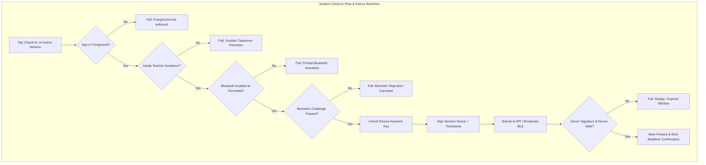
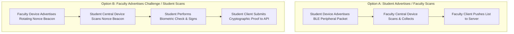
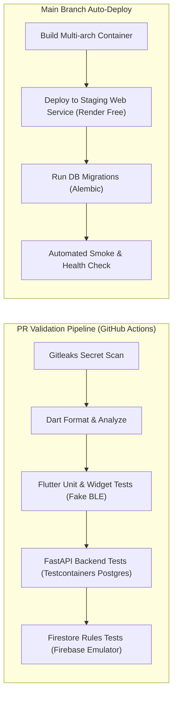

# BLE Attendance Platform — Master Specification & Implementation Plan

**Target System**: Institutional BLE Proximity Mobile Attendance Platform  
**Target Institution (Launch)**: Amrita Vishwa Vidyapeetham (CCE, Chennai Campus)  
**Budget Constraint**: Strict $0.00 / Month Free-Tier Ceiling  
**Document Version**: 1.0.0 (Production Blueprint)  

---

## 1. Product Scope, User Roles & Application Navigation

### 1.1. Role Matrix & Capabilities

| Capability | Student | Faculty | Admin |
| :--- | :---: | :---: | :---: |
| **Authentication** | Institutional Email (`@ch.students.amrita.edu`) | Institutional Email (`@ch.amrita.edu`) | Institutional Admin Email |
| **Account Creation** | Self-signup + Email Verification | Self-signup + Email Verification + Admin Approval | Seeded via backend / console |
| **Course Enrollment** | Request join / Ingested via Roster | Owns assigned courses | Global access across all courses |
| **Session Control** | Join & Poll attendance only | Create, start, pause, close sessions | View all sessions (audited) |
| **Area Geofencing** | Monitored by boundary check | Sets GPS anchor + BLE RSSI threshold | Overrides institutional defaults |
| **Attendance Verification** | Biometric prompt + BLE token | Central scanner validates & compiles roster | Audits anomalies & proxy flags |
| **Overrides & Disputes** | Submits dispute ticket with reason | Approves/rejects with audit note | Final escalation arbiter |
| **Reporting & Export** | Views own attendance & warnings | Exports course CSV/PDF summaries | Exports institutional compliance logs |
| **Account Deletion** | Right to erasure (DPDP Act) | Right to erasure (anonymized records) | Manages tenant data purge |

---

### 1.2. Screen Catalog by Role

#### Shared Authentication Screens
1. **`PortalGateScreen`**: Entry split selecting *Student Portal* or *Faculty Portal*.
2. **`LoginScreen`**: Institutional email/password input, domain check, biometric second factor.
3. **`RegisterScreen`**: Name, roll number, institutional email, parent contact email, password. Directs to email verification holding state.
4. **`EmailVerificationScreen`**: Polling/reload screen blocking access until email link is verified.

#### Student Screens
1. **`StudentHomeScreen`**: Displays active course cards, aggregate attendance percentage, and minimum-attendance warning banners (<75% threshold).
2. **`ActiveSessionCard`**: Visual indicator when an active session for an enrolled course is detected.
3. **`StudentCheckInScreen`**:
   - *State 1: Pre-flight Permissions*: Pre-prompts explaining why Bluetooth, Location, and Biometrics are needed.
   - *State 2: Geofence Validation*: Real-time GPS distance check against the faculty-defined classroom coordinate.
   - *State 3: Biometric Challenge Sheet*: Native BiometricPrompt (fingerprint/face) unlocking the device-bound key.
   - *State 4: BLE Broadcast / Scan Activity*: Active signal transmission with remaining countdown timer.
   - *State 5: Result Screen*: Success confirmation badge with timestamp, or failure card with plain-language explanation.
4. **`StudentHistoryScreen`**: Chronological list of attended/missed lectures with course filter.
5. **`StudentDisputeScreen`**: Form to submit attendance dispensation/dispute with contextual reason.
6. **`StudentProfileScreen`**: Account info, registered device fingerprint, privacy policy, and account deletion trigger.

#### Faculty Screens
1. **`FacultyHomeScreen`**: List of assigned courses with student counts and recent lecture metrics.
2. **`CreateSessionSheet`**: Subject selector, duration picker (default 5 min), GPS classroom anchor capture, and BLE RSSI sensitivity slider (-65 dBm to -85 dBm).
3. **`FacultyActiveSessionScreen`**: Live countdown timer, start/stop scan controls, live roster counts (Present / Total).
4. **`LiveRosterList`**: Real-time list showing detected students, RSSI signal meter, verification timestamp, and manual override toggle.
5. **`ManualOverrideDialog`**: Dialog requiring faculty to select an audited reason (e.g., *Device hardware failure*, *Medical pass*, *Biometric sensor unreadable*) before manually marking present.
6. **`SessionSummaryScreen`**: Post-session analytics, proxy anomaly alerts, and export options.
7. **`CourseHistoryScreen`**: Historical attendance aggregates and CSV report download.

#### Admin Screens
1. **`AdminDashboardScreen`**: System health, active sessions count, pending user approvals.
2. **`UserApprovalScreen`**: Queue of unverified faculty accounts with approve/reject actions.
3. **`InstitutionalAuditScreen`**: Append-only audit log viewer showing user identity, action, IP hash, and timestamp.

---

### 1.3. User Flows & Failure Paths



---

## 2. Zero-Dollar ($0.00) Infrastructure Architecture

To comply with the strict **$0.00 / month budget ceiling**, all cloud services must operate within permanent free tiers. 

### 2.1. Verified Free-Tier Matrix & Card Requirements

| Layer | Selected Service | Free-Tier Allowance (Verified Official Docs) | Credit Card / Billing Required? | Cost-Trap & Overdraft Prevention | Official Source Citation |
| :--- | :--- | :--- | :---: | :--- | :--- |
| **Auth & Ephemeral Live State** | **Firebase Spark Plan** | - Auth: Unlimited Email/Password<br>- Firestore: 50,000 reads/day, 20,000 writes/day, 1 GB storage<br>- Hosting: 10 GB storage, 360 MB/day egress | **NO** | Hard platform quota. Operations fail with `RESOURCE_EXHAUSTED` if exceeded; impossible to charge card. Cloud Functions blocked. | [Firebase Pricing](https://firebase.google.com/pricing) |
| **Authoritative DB (System of Record)** | **Neon Serverless PostgreSQL** | - 0.5 GB storage<br>- Shared compute (auto-suspend on idle)<br>- Full PostgreSQL wire protocol | **NO** | Zero-billing guarantee; compute pauses when inactive. Engine configured with `pool_pre_ping=True` to absorb wakeups. | [Neon Pricing](https://neon.tech/pricing) |
| **API Compute** | **Render Web Services** | - 750 free instance hours/month (runs 1 web service 24/7)<br>- 512 MB RAM, 0.1 vCPU<br>- 100 GB egress/month | **NO** | Spins down after 15 min idle; auto-wakes on HTTP request (~30s cold start). Free tier rejects overages with 0 charge. | [Render Free Tier Docs](https://render.com/docs/free) |
| **Alternative Container Compute** | **Hugging Face Spaces (Docker)** | - 16 GB RAM, 2 vCPU<br>- 50 GB storage<br>- Persistent free compute | **NO** | Excellent backup container host requiring no payment method. | [HF Spaces Pricing](https://huggingface.co/pricing) |
| **Edge / Proxy / TLS** | **Cloudflare Free Tier** | - Free Universal SSL/TLS<br>- DDoS mitigation<br>- Basic Web Application Firewall & rate limits | **NO** | Standard free plan requires no payment credentials for DNS and proxy caching. | [Cloudflare Plans](https://www.cloudflare.com/plans/) |
| **Error Monitoring** | **Sentry Developer Tier** | - 5,000 error events/month<br>- 10,000 transaction traces/month | **NO** | Ingestion stops at limit; no automatic overage charges. | [Sentry Pricing](https://sentry.io/pricing/) |
| **CI/CD Pipeline** | **GitHub Actions** | - Unlimited build minutes for public repositories<br>- 2,000 min/mo for private | **NO** | Public repo workflows run completely free. | [GitHub Actions Billing](https://docs.github.com/billing/managing-billing-for-github-actions) |
| **Object Storage (Reports)** | **Supabase Storage** (or local export) | - 1 GB file storage<br>- 2 GB egress/month | **NO** | Uses Supabase free tier (no card needed) rather than Cloudflare R2 (which requires a card on file). | [Supabase Pricing](https://supabase.com/pricing) |
| **AI Assistant (Phase 5)** | **Google Gemini API via Google AI Studio** | - 15 RPM (Requests Per Minute)<br>- 1,500 RPD (Requests Per Day)<br>- 1M tokens/min on `gemini-1.5-flash` | **NO** | Free tier via Google AI Studio requires only a Google login; no Cloud Billing or card needed. | [Gemini API Pricing](https://ai.google.dev/pricing) |

> [!CAUTION]
> **Identified Traps Excluded from the $0 Plan**:
> - **Google Cloud Run**: Requires a linked Cloud Billing account with an active credit card. Excluded to eliminate risk of unexpected compute/Artifact Registry charges.
> - **Cloudflare R2**: Requires a payment method on file to provision buckets despite having a 10 GB free tier. Excluded in favor of Supabase Storage (no card needed).
> - **Firebase Blaze Plan**: Never upgrade the Firebase project to Blaze. Cloud Functions remain disabled, preserving client-to-backend API architecture.

---

## 3. Data Model & Dual-Store Authority

### 3.1. Entity Source of Truth Definition

| Entity | Authoritative Source of Truth | Ephemeral Cache Layer | Synchronization Mechanism |
| :--- | :--- | :--- | :--- |
| **User Identities & Roles** | **PostgreSQL** (`users` table) | Firebase Auth custom claims / Firestore `users` | Background sync on user verification / update |
| **Courses & Enrollments** | **PostgreSQL** (`courses`, `enrollments`) | None | Direct API queries |
| **Registered Devices & Keys** | **PostgreSQL** (`devices` table) | None | Verified at API check-in gate |
| **Active Sessions** | **PostgreSQL** (`sessions` table) | **Cloud Firestore** (`sessions/{id}`) | Backend creates session in both Postgres and Firestore simultaneously |
| **Attendance Records** | **PostgreSQL** (`attendance_records` table) | **Cloud Firestore** (`sessions/{id}/attendance/{uid}`) | API validates check-in, writes to Postgres, then streams receipt to Firestore |
| **Audit Logs** | **PostgreSQL** (`audit_log` table, append-only) | None | Direct write from backend middleware |

---

### 3.2. PostgreSQL Schema (DDL)

```sql
-- Enable UUID and Vector extensions
CREATE EXTENSION IF NOT EXISTS "uuid-ossp";
CREATE EXTENSION IF NOT EXISTS "vector";

-- 1. Institutions
CREATE TABLE institutions (
    id UUID PRIMARY KEY DEFAULT uuid_generate_v4(),
    code VARCHAR(32) UNIQUE NOT NULL,
    name VARCHAR(255) NOT NULL,
    domain VARCHAR(128) UNIQUE NOT NULL,
    created_at TIMESTAMPTZ DEFAULT NOW()
);

-- 2. Users Table
CREATE TABLE users (
    id UUID PRIMARY KEY DEFAULT uuid_generate_v4(),
    firebase_uid VARCHAR(128) UNIQUE NOT NULL,
    institution_id UUID REFERENCES institutions(id) ON DELETE RESTRICT,
    email VARCHAR(255) UNIQUE NOT NULL,
    role VARCHAR(32) NOT NULL CHECK (role IN ('student', 'faculty', 'admin')),
    display_name VARCHAR(255) NOT NULL,
    roll_number VARCHAR(64),
    status VARCHAR(32) DEFAULT 'pending_verification' CHECK (status IN ('pending_verification', 'verified', 'suspended')),
    created_at TIMESTAMPTZ DEFAULT NOW(),
    updated_at TIMESTAMPTZ DEFAULT NOW()
);

-- 3. Devices Table (Bound cryptographic public keys)
CREATE TABLE devices (
    id UUID PRIMARY KEY DEFAULT uuid_generate_v4(),
    user_id UUID NOT NULL REFERENCES users(id) ON DELETE CASCADE,
    public_key_fingerprint VARCHAR(128) UNIQUE NOT NULL,
    public_key_pem TEXT NOT NULL,
    platform VARCHAR(32) NOT NULL CHECK (platform IN ('android', 'ios')),
    device_model VARCHAR(128),
    os_version VARCHAR(64),
    attestation_status VARCHAR(32) DEFAULT 'unverified',
    registered_at TIMESTAMPTZ DEFAULT NOW(),
    revoked_at TIMESTAMPTZ
);
CREATE INDEX idx_devices_user ON devices(user_id) WHERE revoked_at IS NULL;

-- 4. Courses Table
CREATE TABLE courses (
    id UUID PRIMARY KEY DEFAULT uuid_generate_v4(),
    institution_id UUID REFERENCES institutions(id) ON DELETE RESTRICT,
    code VARCHAR(64) NOT NULL,
    name VARCHAR(255) NOT NULL,
    faculty_id UUID NOT NULL REFERENCES users(id) ON DELETE RESTRICT,
    term VARCHAR(64) NOT NULL,
    created_at TIMESTAMPTZ DEFAULT NOW(),
    UNIQUE(institution_id, code, term)
);

-- 5. Enrollments Table
CREATE TABLE enrollments (
    id UUID PRIMARY KEY DEFAULT uuid_generate_v4(),
    course_id UUID NOT NULL REFERENCES courses(id) ON DELETE CASCADE,
    student_id UUID NOT NULL REFERENCES users(id) ON DELETE CASCADE,
    enrolled_at TIMESTAMPTZ DEFAULT NOW(),
    status VARCHAR(32) DEFAULT 'active' CHECK (status IN ('active', 'dropped')),
    UNIQUE(course_id, student_id)
);

-- 6. Sessions Table
CREATE TABLE sessions (
    id UUID PRIMARY KEY DEFAULT uuid_generate_v4(),
    course_id UUID NOT NULL REFERENCES courses(id) ON DELETE CASCADE,
    started_by UUID NOT NULL REFERENCES users(id) ON DELETE RESTRICT,
    room_label VARCHAR(128) NOT NULL,
    latitude DOUBLE PRECISION NOT NULL,
    longitude DOUBLE PRECISION NOT NULL,
    geofence_radius_meters DOUBLE PRECISION DEFAULT 25.0,
    rssi_threshold INT DEFAULT -75,
    secret_hash VARCHAR(128) NOT NULL,
    opens_at TIMESTAMPTZ NOT NULL,
    closes_at TIMESTAMPTZ NOT NULL,
    status VARCHAR(32) DEFAULT 'active' CHECK (status IN ('active', 'closed')),
    created_at TIMESTAMPTZ DEFAULT NOW()
);
CREATE INDEX idx_sessions_course ON sessions(course_id, opens_at);

-- 7. Attendance Records Table
CREATE TABLE attendance_records (
    id UUID PRIMARY KEY DEFAULT uuid_generate_v4(),
    session_id UUID NOT NULL REFERENCES sessions(id) ON DELETE CASCADE,
    student_id UUID NOT NULL REFERENCES users(id) ON DELETE RESTRICT,
    device_id UUID NOT NULL REFERENCES devices(id) ON DELETE RESTRICT,
    method VARCHAR(32) NOT NULL CHECK (method IN ('ble_signed_nonce', 'faculty_manual_override')),
    rssi_observed INT,
    signature_verified BOOLEAN NOT NULL DEFAULT TRUE,
    verified_at TIMESTAMPTZ DEFAULT NOW(),
    status VARCHAR(32) DEFAULT 'present' CHECK (status IN ('present', 'disputed', 'revoked')),
    CONSTRAINT uq_session_student UNIQUE(session_id, student_id)
);
CREATE INDEX idx_attendance_student ON attendance_records(student_id, verified_at);

-- 8. Overrides & Disputes Table
CREATE TABLE overrides (
    id UUID PRIMARY KEY DEFAULT uuid_generate_v4(),
    record_id UUID REFERENCES attendance_records(id) ON DELETE CASCADE,
    session_id UUID NOT NULL REFERENCES sessions(id) ON DELETE CASCADE,
    student_id UUID NOT NULL REFERENCES users(id) ON DELETE RESTRICT,
    actor_id UUID NOT NULL REFERENCES users(id) ON DELETE RESTRICT,
    reason TEXT NOT NULL,
    action VARCHAR(32) NOT NULL CHECK (action IN ('grant', 'revoke')),
    created_at TIMESTAMPTZ DEFAULT NOW()
);

-- 9. Append-Only Audit Log
CREATE TABLE audit_log (
    id BIGSERIAL PRIMARY KEY,
    actor_id UUID REFERENCES users(id) ON DELETE SET NULL,
    action VARCHAR(128) NOT NULL,
    target_entity VARCHAR(64) NOT NULL,
    target_id VARCHAR(128) NOT NULL,
    ip_hash VARCHAR(64) NOT NULL,
    request_id VARCHAR(64) NOT NULL,
    payload JSONB,
    created_at TIMESTAMPTZ DEFAULT NOW()
);

-- 10. Policy Chunks (Phase 5 AI Embeddings)
CREATE TABLE policy_chunks (
    id UUID PRIMARY KEY DEFAULT uuid_generate_v4(),
    institution_id UUID REFERENCES institutions(id) ON DELETE CASCADE,
    source_document VARCHAR(255) NOT NULL,
    content TEXT NOT NULL,
    embedding vector(768),
    created_at TIMESTAMPTZ DEFAULT NOW()
);
```

---

### 3.3. Firestore Collections (Ephemeral Realtime)

1. **`sessions/{sessionId}`**:
   ```json
   {
     "courseId": "uuid",
     "courseCode": "CSE312",
     "subjectName": "Computer Networks",
     "facultyId": "firebase_uid",
     "latitude": 12.8994,
     "longitude": 80.2285,
     "radiusMeters": 25.0,
     "rssiThreshold": -75,
     "opensAt": "2026-11-12T10:00:00Z",
     "closesAt": "2026-11-12T10:05:00Z",
     "status": "active"
   }
   ```
2. **`sessions/{sessionId}/attendance/{studentUid}`**:
   ```json
   {
     "studentName": "Bob Smith",
     "rollNo": "CH.EN.U4CSE21001",
     "verifiedAt": "2026-11-12T10:02:14Z",
     "method": "ble_signed_nonce",
     "rssi": -68
   }
   ```

---

## 4. API Surface Specification (FastAPI / OpenAPI)

All endpoints enforce Bearer JWT authentication (Firebase ID Token), validate email verification, attach a unique `X-Request-Id` for tracing, and log to `audit_log`.

### 4.1. Endpoint Registry

| Method | Path | Auth / Role | Description | Error Codes |
| :--- | :--- | :--- | :--- | :--- |
| `POST` | `/api/v1/auth/sync-profile` | Any Authenticated | Ingests Firebase User, maps domain to role | `400, 401, 403` |
| `POST` | `/api/v1/devices/register` | Student | Registers device-bound public key PEM | `400, 401, 409` |
| `POST` | `/api/v1/devices/revoke` | Student / Admin | Revokes existing device key | `401, 404` |
| `GET` | `/api/v1/courses` | Any Authenticated | Lists courses for user (filtered by role) | `401` |
| `POST` | `/api/v1/courses/{id}/roster` | Faculty (Course Owner) | Uploads CSV student roster | `400, 401, 403` |
| `POST` | `/api/v1/sessions/start` | Faculty (Course Owner) | Creates session with geofence anchor | `400, 401, 403` |
| `POST` | `/api/v1/sessions/{id}/close` | Faculty (Course Owner) | Ends session early | `401, 403, 404` |
| `GET` | `/api/v1/sessions/{id}/nonce` | Enrolled Student | Retrieves rotating 30s challenge nonce | `401, 403, 410` |
| `POST` | `/api/v1/sessions/check-in` | Enrolled Student | Submits signed presence token | `400, 401, 403, 409, 422` |
| `POST` | `/api/v1/sessions/{id}/override` | Faculty (Course Owner) | Manually marks student with audit reason | `400, 401, 403` |
| `GET` | `/api/v1/courses/{id}/reports` | Faculty / Admin | Streams CSV export of attendance | `401, 403` |
| `POST` | `/api/v1/assistant/chat` | Any Authenticated | Scoped Q&A via parameterized tools | `401, 429, 503` |

### 4.2. Cryptographic Check-in Request & Response Schemas

#### `POST /api/v1/sessions/check-in` Request:
```json
{
  "sessionId": "4b68e98e-e77a-4c28-9844-3d9178ad3a94",
  "nonce": "a1b2c3d4e5f60718",
  "clientTimestamp": "2026-11-12T10:02:14Z",
  "deviceLatitude": 12.89941,
  "deviceLongitude": 80.22853,
  "rssiObserved": -71,
  "signature": "MEQCIC...base64_encoded_ecdsa_signature..."
}
```

#### Signature Verification Payload:
The signature must be generated over the UTF-8 bytes of:
`"ATTENDANCE_CHECKIN:{sessionId}:{nonce}:{studentId}:{deviceLatitude}:{deviceLongitude}"`

#### Response:
```json
{
  "status": "success",
  "recordId": "9f7a5b3c-2211-4099-b1d1-6e8201a0bcde",
  "verifiedAt": "2026-11-12T10:02:15.102Z",
  "studentName": "Bob Smith",
  "courseCode": "CSE312"
}
```

---

## 5. BLE Proximity Architecture & Spike Protocol (Phase 1)

Neither Option A nor Option B is presumed the winner. Phase 1 evaluates both options under real-device hardware conditions.



### 5.1. Option Specifications & iOS Constraints

#### Option A: Student Advertises, Faculty Scans
- **Mechanism**: The student's phone acts as a BLE peripheral. Upon biometric success, it broadcasts an advertisement containing an identifier and cryptographic fragment. The faculty phone scans as central.
- **iOS Platform Limitation**:
  - In peripheral mode, iOS apps **cannot broadcast arbitrary manufacturer data or custom service data**. iOS only permits broadcasting a local name and standard 128-bit Service UUIDs.
  - When backgrounded, iOS advertising is heavily throttled and custom local names are stripped.
  - The payload must fit within the 31-byte legacy BLE advertisement limit.

#### Option B: Faculty Advertises Beacon, Student Scans & Submits
- **Mechanism**: Faculty phone acts as a peripheral advertising a single rotating 30-second nonce (or short GATT service). All student phones scan as central, read the live in-room nonce, pass the biometric challenge, sign `{sessionId, nonce, studentId}` using the Keystore/Secure Enclave key, and transmit it directly to the API over Wi-Fi/cellular.
- **Advantage**: Bypasses the iOS peripheral advertising payload limitation, since iOS acts as a central scanner (which has full payload read access).

#### Option C: Hybrid
- Option B provides the authoritative cryptographic proof submitted to the API, while Option A is used for optional near-field visual discovery on the faculty device screen.

### 5.2. Spike Test Suite & Pass/Fail Criteria

Field tests will be executed on **at least 2 Android devices (different OEMs: e.g. Samsung, Xiaomi/OnePlus)** and **at least 2 iPhones (iOS 16+)** evaluating:
1. **Advertising Reliability**: Advertisement success rate when broadcasting 50 packets. (Pass: >95% reception).
2. **Scan Discovery Latency**: Time to discover peripheral from a cold scan. (Pass: <3.0 seconds).
3. **RSSI Stability & Distance Gradient**: Measured RSSI at 1m, 3m, 5m, 10m, and outside a closed classroom door. (Pass: distinguishable signal drop of >15 dBm through door/wall).
4. **Foreground Battery Drain**: Battery consumption during a continuous 10-minute check-in session. (Pass: <1.5% battery drain).
5. **Cross-Platform Interoperability**: Android central scanning iOS peripheral, and iOS central scanning Android peripheral.

---

## 6. Threat Modeling & Security Regression Matrix

| Threat ID | Threat Vector | Attack Description | Mitigation in Architecture | Regression Test Requirement |
| :--- | :--- | :--- | :--- | :--- |
| **TH-01** | **Proxy Attendance (Credential Sharing)** | Student gives college email/password to a friend to check in. | **Hardware Device-Bound Key**: Key is bound to Secure Enclave / Android Keystore. Private key cannot be exported or cloned. | Attempt check-in using valid credentials on an unregistered device (Must fail 403). |
| **TH-02** | **Proxy Attendance (BLE Sniff & Re-broadcast)** | Student sniffs rotating HMAC from the air and broadcasts with friend's UID. | **Cryptographic Nonce Signature**: Each payload is signed by the student's unique private key over `{nonce, studentId}`. | Sniff packet and retransmit with altered UID (Must fail signature check). |
| **TH-03** | **BLE Relay Attack** | Attacker relays BLE packets via Wi-Fi/tunnel to a student outside the hall. | **Dual Perimeter (GPS Geofence + RSSI Dwell)**: Check-in enforces device GPS coordinates within faculty radius + windowed median RSSI. | Submit valid BLE signature with GPS coordinates outside the 25m radius (Must fail). |
| **TH-04** | **Replay Attack** | Attacker captures a valid signature and resends it after class. | **Strict Nonce Bucket Expiry**: Server accepts nonces valid only for the current and immediately prior 30-second bucket ($\pm 30$s drift). | Submit token captured >60 seconds prior (Must fail 410 Expired). |
| **TH-05** | **Device Swapping** | One student logs into multiple accounts on a single phone to mark multiple peers. | **1:1 Device Binding Rule**: A registered device fingerprint can be associated with only one active student account. | Register device key fingerprint already claimed by another user (Must fail 409 Conflict). |
| **TH-06** | **Rooted / Tampered Devices** | Student hooks app memory or uses mock location software. | **Play Integrity / App Attest + Mock Location Detection**: Detect `isMockLocation` and rooted states; deny check-in if compromised. | Test mocked GPS coordinates in Android developer options (App must reject). |
| **TH-07** | **Role Escalation** | Student modifies client request to assign themselves `role: faculty` or `admin`. | **Server-Enforced Claims & DB Roles**: Roles are assigned exclusively server-side in PostgreSQL. Clients cannot write their own role. | Attempt `POST /api/v1/sessions/start` with student JWT (Must fail 403 Forbidden). |
| **TH-08** | **UID Truncation Collision** | Two students sharing first 8 characters of UID collide in scanner. | **Full UUID Usage**: The 8-byte truncation is eliminated. Check-ins use full 128-bit UUIDs. | Test 10,000 generated synthetic student IDs for collision tolerance. |
| **TH-09** | **Soft-Failing Biometrics** | Student bypasses biometric prompt on device. | **Strict LocalAuth Gate**: Attendance check-in screen blocks Keystore signature generation until biometric prompt succeeds with strong biometric (Class 3). | Mock biometric failure in unit test (Must block signature generation). |

---

## 7. Edge-Case Matrix

| Edge Case | Category | Architectural Decision | Test Strategy |
| :--- | :--- | :--- | :--- |
| **Bluetooth Disabled Mid-Session** | Hardware | App detects adapter state change via stream; immediately pauses scan/broadcast and displays recovery prompt. | State stream unit test. |
| **Phone Backgrounded / Screen Locked** | OS Lifecycle | Foreground lock terminates session immediately; clears active nonce from memory. | `WidgetsBindingObserver` lifecycle test. |
| **Aggressive OEM Battery Killer (Xiaomi/Vivo)** | OS / Power | App prompts user to exempt app from aggressive battery saver during setup. | Documented OEM setup guide. |
| **Adjacent Classroom Running Session** | Radio Interference | Nonces and beacons are cryptographically scoped to `sessionId`. Students cannot check into neighboring rooms. | Multi-session cross-check unit test. |
| **No Biometrics Enrolled on Device** | User / Device | Student cannot use BLE auto check-in; must request audited manual override from faculty. | UI fallback test when `canCheckBiometrics == false`. |
| **Student Enrolled in Overlapping Courses** | Academic Policy | Backend flags scheduling conflict; prevents concurrent check-ins. | Unique constraint test on active session intervals. |
| **Faculty App Dies Mid-Session** | Connectivity | Session state lives on the server; session auto-expires at deadline even if faculty phone goes offline. | Server-side scheduled expiry test. |
| **Clock Skew Between Devices** | Timing | Server time is sole source of truth; backend accepts $\pm 1$ time bucket (30s) tolerance. | Artificially inject $\pm 25$s client timestamp drift. |

---

## 8. Test Strategy & CI/CD Pipeline



### Coverage Thresholds:
- Backend Business Logic & Auth: **>90% line coverage**.
- Cryptographic Token Derivation & Verification: **100% path coverage**.
- Flutter Domain Models & Services: **>80% line coverage**.

---

## 9. Phase Roadmap (Phases 1 to 7)

| Phase | Scope | Entry Gate | Exit Criteria | Deliverables | Est. Days |
| :---: | :--- | :--- | :--- | :--- | :---: |
| **Phase 1** | **BLE Hardware Spike** | Phase 0 approved | Measured reliability table on 2 Android + 2 iOS physical devices; ADR choosing Option A, B, or C | Spike test harness, field-test logs in `docs/ble-field-tests/`, ADR-0005 | 3 days |
| **Phase 2** | **Core Mobile & Biometric Client** | Phase 1 ADR approved | Mobile app with biometric-gated Keystore signing, geofence radius check, zero soft-fails | Updated Flutter screens, Keystore/Secure Enclave service, widget tests | 4 days |
| **Phase 3** | **$0 Backend & PostgreSQL** | Phase 2 completed | FastAPI backend, Neon Postgres migrations, full negative security test suite passing | Dockerized FastAPI app, Alembic migrations, OpenAPI spec, Testcontainer tests | 4 days |
| **Phase 4** | **Free Cloud Pipeline & Deployment** | Phase 3 tests green | Staging deployment live on Render free tier, GitHub Actions CI/CD green, 300-in-60s local load test | Cloud deployment, CI/CD workflows, Locust load test scripts | 3 days |
| **Phase 5** | **AI Assistant (Free Tier Gemini)** | Phase 4 stable | Policy RAG with pgvector using Gemini API free tier, 30-prompt adversarial eval suite passing | RAG pipeline, parameterized query tools, AI evaluation runner | 3 days |
| **Phase 6** | **Polish, Accessibility & DPDP Review** | Phase 5 passed | WCAG 2.1 AA accessibility pass, DPDP Act consent and deletion flow verified | In-app account deletion, localization strings, privacy documentation | 2 days |
| **Phase 7** | **Android Pilot & Distribution** | Phase 6 completed | Successful live classroom pilot with 1 faculty and enrolled student cohort | Production APK release, pilot accuracy report, store release submission | 3 days |

---

## 10. Store Release Plan

### 10.1. Google Play Store (Phase 7 - Android First)
- **Account Fee**: $25 one-time developer registration fee.
- **Account Policy Requirement**:
  - For personal developer accounts created after November 13, 2023, Google requires a **closed test with at least 20 testers opted in for at least 14 continuous days** before production access is unlocked.
  - *Mitigation for Student Cohort*: Deploy initially via **Internal Testing Track** (up to 100 testers, no 14-day wait) or direct institutional APK distribution.
- **Permission Declarations**:
  - `BLUETOOTH_SCAN`, `BLUETOOTH_ADVERTISE`, `BLUETOOTH_CONNECT` declared with clear in-app justification dialogues.
  - Data Safety Form: Accurately declaring no personal data shared with third parties, location used strictly for in-class proximity, zero biometric data collection.

### 10.2. Apple App Store (Deferred Pending Account)
- **Account Fee**: $99/year Apple Developer Program.
- **University Account Inquiry**: Advise user to check whether Amrita Vishwa Vidyapeetham has an active University Organization Developer account.
- **Compliance Requirements**:
  - `NSBluetoothAlwaysUsageDescription` and `NSFaceIDUsageDescription` configured with user-facing purpose strings.
  - Mandatory in-app account deletion workflow supporting instantaneous data erasure.

---

## 11. Open Questions & Recommended Defaults

| # | Item | Question | Recommended Default |
| :- | :--- | :--- | :--- |
| **Q1** | **Architecture Mode** | Pilot mode (Render free container) vs. Local K8s showcase? | **Pilot mode on Render Free Tier** ($0/month). |
| **Q2** | **Authoritative Database** | Neon Serverless Postgres vs. Supabase Postgres? | **Neon Postgres Free Tier** (0.5 GB storage, auto-suspend compute, standard wire protocol). |
| **Q3** | **Roster Format** | CSV header schema for faculty upload? | **`roll_number, full_name, college_email`** ingested per course. |
| **Q4** | **Faculty Approval** | Admin manual approval mechanism? | **Admin dashboard queue** approving registered faculty emails. |
| **Q5** | **BLE Direction** | Presumed BLE model? | **Spike both Option A and Option B** on physical devices during Phase 1 without presuming winner. |
| **Q6** | **Offline Mode** | Reject or short-grace queue? | **Strictly reject offline check-ins** to preserve zero-trust server authority. |
| **Q7** | **Check-in Frequency** | Single check-in or continuous? | **Single 5-minute check-in window** with optional faculty-triggered mid-class re-check. |
| **Q8** | **App Store Accounts** | Personal or University? | **Android first via Internal Testing** while university Apple account status is investigated. |
| **Q9** | **Monthly Budget** | Cloud spend ceiling? | **Strict $0.00 / month** using verified free tiers without credit card attachments. |
| **Q10**| **Languages** | Multilingual support? | **English primary**, Flutter localization structure prepared for Tamil and Hindi. |
| **Q11**| **Data Retention** | Institutional data retention? | **1 academic year (records), 90 days (logs)** marked as unconfirmed assumption pending university confirmation. |
| **Q12**| **AI Provider** | LLM API provider? | **Google Gemini API Free Tier** (via Google AI Studio, no card required) for Phase 5. |
